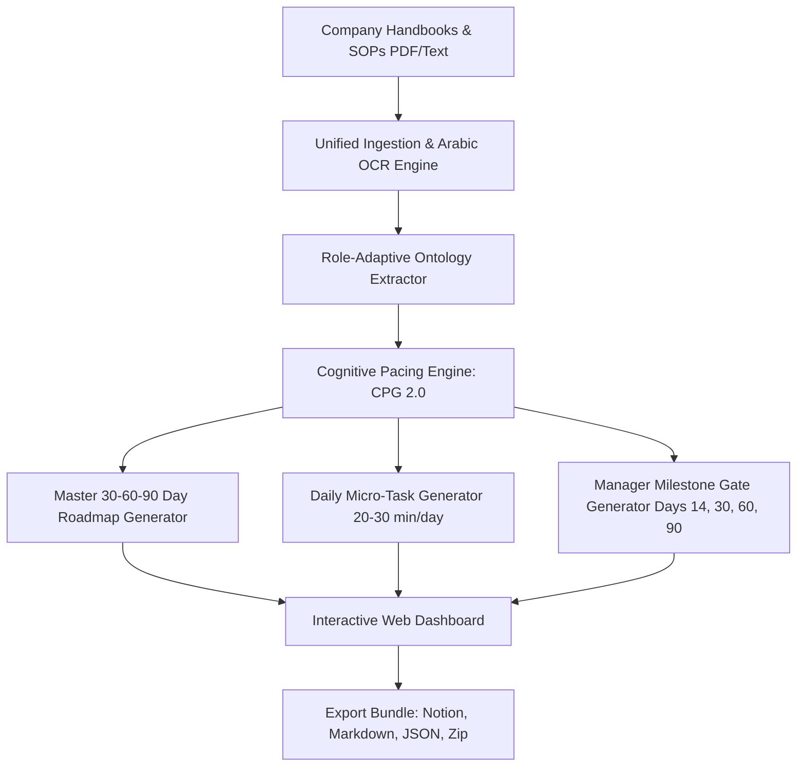

# Implementation Plan: Taheel AI (نظام التأهيل الذكي)

Transform the academic `T1_SmartSyllabus` codebase into **Taheel AI (تأهيل)**: an enterprise-grade, role-adaptive 30-60-90 day employee onboarding and probation governance engine. The system ingests company handbooks, operational SOPs, and policy manuals (in Arabic and/or English), balances the new hire's cognitive load across the standard 90-day Saudi probation timeline (Article 53), and produces an actionable hybrid system: exportable Notion/Markdown packages alongside an interactive manager and employee dashboard.

---

## Confirmed System Requirements & Decisions

| Dimension | Specification |
| :--- | :--- |
| **Product Delivery Model** | **Hybrid:** Interactive Web Dashboard (Streamlit/FastAPI) + Exportable Packages (Markdown, Notion-ready templates, and printable checklists). |
| **Personalization Engine** | **Role-Adaptive:** Ingests general company manuals, but filters and prioritizes competencies based on user-selected Department and Job Title (e.g. *Customer Support Specialist*, *Junior Software Engineer*, *Operations Associate*). |
| **Verification & Governance** | **Dual-Layer:**  1. Simple Daily Checklists (mark 20–30 min micro-actions as done). 2. **Manager 1-on-1 Milestone Rubrics** at **Days 14, 30, 60, and 90** with structured probation pass/risk scoring. |
| **Language & Compliance** | **Bilingual (Arabic & English):** Native RTL text normalization and explicit alignment with **Saudi Labor Law Article 53 (90-Day Probation Period)** and Tamheer/HRDF standards. |

---

## System Architecture

---

## Proposed Changes & File Structure

All new enterprise code will live cleanly inside `src/enterprise_onboarding/` (or `src/taheel/` in the new repo), keeping the existing academic syllabus codebase intact for reference and safety.

### 1. Data Contracts & Domain Models
#### [NEW] `src/taheel/schema.py`
Pydantic schemas for the complete lifecycle:
- `RoleProfile`: Company name, department, target role, mentor name, language (`ar` / `en`).
- `MilestonePhase`: Phase 1 (Days 1–30: Foundation & Orientation), Phase 2 (Days 31–60: Guided Execution), Phase 3 (Days 61–90: Independent Ownership & Probation Gate).
- `SOPItem`: SOP ID, title, summary, source page range, tooling/access needed, risk/complexity level.
- `DailyMicroTask`: Day number (1–90), week number, topic, estimated time (20–30 mins), core SOP rule, practical action step, status checkbox.
- `ManagerEvaluationGate`: Milestone day (14, 30, 60, 90), core competencies to review, 1-on-1 interview questions, scoring rubric (1–5), probation readiness verdict.

---

### 2. Ingestion & Cognitive Pacing
#### [NEW] `src/taheel/ingestion/pdf_engine.py` & `arabic_cleaner.py`
- Refactors and unifies [src/app/pdf.py](file:///c:/Users/themi/PycharmProjects/Old/T1_SmartSyllabus/src/app/pdf.py) and [Delay/arabic_book_parser.py](file:///c:/Users/themi/PycharmProjects/Old/T1_SmartSyllabus/Delay/arabic_book_parser.py).
- Multi-engine document processing: PyMuPDF for digital text, EasyOCR for local OCR, and Gemini/Vision LLM for complex layouts.
- Native Arabic text cleaning (removing tatweel, normalizing hamzas, encoding fixes).
- Multi-document support: in addition to a single PDF, allows ingesting multiple SOP attachments.

#### [NEW] `src/taheel/pacing/cognitive_engine.py`
- Evolves [src/CPG/main.py](file:///c:/Users/themi/PycharmProjects/Old/T1_SmartSyllabus/src/CPG/main.py) into an employee cognitive load balancing engine.
- Prevents new-hire cognitive overload: enforces daily time limits (20–30 mins/day for training) so employees have time for daily tasks and shadowing.
- Distributes learning density mathematically across the 90-day window, placing high-complexity compliance/SOPs in Weeks 2–4 and advanced troubleshooting in Weeks 6–10.

---

### 3. Core Generators (Ontology, Roadmap, Daily Tasks, Manager Gates)
#### [NEW] `src/taheel/generators/ontology.py`
- Analyzes raw handbook/SOP text against the specified `RoleProfile` (e.g. filters technical engineering SOPs if onboarding a Customer Support hire).
- Outputs structured JSON of relevant competencies and procedures.

#### [NEW] `src/taheel/generators/roadmap.py`
- Produces the executive-facing and employee-facing **Master 30-60-90 Day Roadmap** in clean Markdown tables and JSON.
- Highlights weekly themes, target SOPs, expected outcomes, and gate weeks.

#### [NEW] `src/taheel/generators/daily_tasks.py`
- Practical **Daily Micro-Action Cards**:
  1. *Daily Objective & Role Relevance (3 mins)*
  2. *Core SOP Rule & Common Mistakes to Avoid (7 mins)*
  3. *Hands-on Action Task in Company Tools (15 mins)*
  4. *Quick Checkbox Confirmation (mark as done)*

#### [NEW] `src/taheel/generators/manager_gates.py`
- Dedicated generator for formal 1-on-1 manager review cards at **Day 14 (Early Healthcheck)**, **Day 30 (Foundation Review)**, **Day 60 (Execution Review)**, and **Day 90 (Final Probation Decision)**.
- Formatted with structured rubrics, red flags to watch for, and Saudi Labor Law compliance documentation.

#### [NEW] `src/taheel/exporters/notion_bundle.py`
- Converters that format the output into:
  - **Notion-ready Markdown** (with callouts, toggle lists, and checkboxes).
  - Standard Markdown files organized in directories.
  - Complete `.zip` packaging for one-click download.

---

### 4. Interactive Web Application & API
#### [NEW] `src/taheel/api/main.py`
- FastAPI endpoints for asynchronous processing, role selection, job progress tracking, and downloading exported bundles.

#### [NEW] `src/taheel/ui/app.py`
- Modern corporate Streamlit interface:
  - **Role & Company Setup:** Input Company, Department, Role Title, and Language.
  - **Document Upload:** Ingest PDF/Text SOPs with live progress bar.
  - **30-60-90 Interactive Timeline:** Visual progress stepper (Days 1–30 / 31–60 / 61–90).
  - **Manager Gates Tab:** View Day 14, 30, 60, and 90 review rubrics.
  - **Export Center:** One-click download for Notion, Markdown, and Zip packages.

---

## Synthetic Data for Instant Testing (No Protected Data Needed)
#### [NEW] `data/sample_sops/fintech_customer_ops_sop.md`
- A realistic, bilingual (Arabic & English) mock enterprise manual: *"RiyadhPay / راية باي: Customer Operations & Incident Response SOP Manual"*.
- Allows testing the complete pipeline end-to-end immediately without proprietary corporate documents.

---

## Verification Plan

### Automated Verification
1. **Schema Integrity:** Verify all generated JSON validates cleanly against Pydantic models in `schema.py`.
2. **Pacing Math Check:** Verify that cognitive load calculation correctly allocates micro-tasks within the 20–30 min daily window and correctly maps gates to Days 14, 30, 60, and 90.
3. **Bilingual Text Handling:** Verify that Arabic characters are normalized without reversed text or garbled encoding.

### End-to-End Functional Verification
1. Run pipeline against the mock enterprise manual with role *"Customer Support Specialist"*.
2. Confirm generation of:
   - `roadmap_30_60_90.md`
   - `manager_gates_review.md` (Days 14, 30, 60, 90)
   - Sample daily task cards (Days 1–5)
   - Export `.zip` bundle
3. Launch Streamlit UI (`streamlit run src/taheel/ui/app.py`) to verify visual interactive dashboard.
